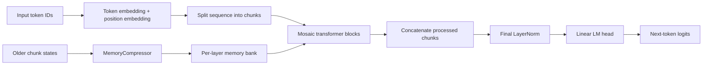
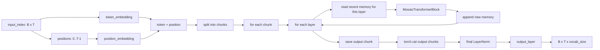
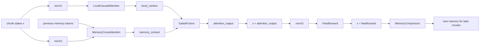
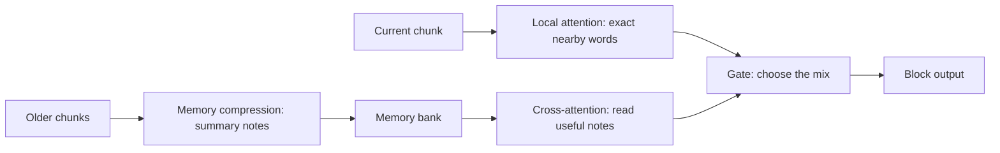
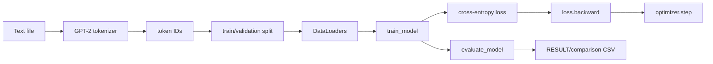

# Understanding MosaicFormer

This note explains the project in the same order the code runs. The goal is not
to make the idea sound complicated. The goal is to make every tensor movement
traceable.

## 1. Big Picture

MosaicFormer is a decoder-only language model. It still predicts the next token
like GPT, but it changes how attention sees long context.



Plain English:

1. Tokens become vectors.
2. The sequence is split into fixed-size chunks.
3. Each chunk gets exact local attention.
4. Finished chunks are compressed into a few memory tokens.
5. Later chunks can read those compressed memory tokens.
6. The final output is normal language-model logits.

## 2. Simple Human Analogy

Imagine you are reading a long story.

For the sentence you are reading right now, you need exact nearby words. If the
sentence says "she picked it up", the words just before it help you know what
"it" means. That is the local attention part.

But you do not keep every word from five pages ago in your active mind. You keep
a summary: who the people are, what happened, what object matters, and what
problem is still unresolved. That is the memory compression part.

When the current sentence needs older information, your mind checks the summary.
When it does not need older information, your mind stays focused on the nearby
sentence. That decision is the gated fusion part.

So MosaicFormer is trying to copy this reading habit:

```text
near words = exact detail
old words = compressed memory
gate = decide how much old memory to use
```

## 3. New Terms In Simple Words

### Token

A token is a small piece of text. It can be a word, part of a word, punctuation,
or a space-like piece. The model does not read raw English directly. It reads
token IDs, which are numbers.

### Embedding

An embedding is the model's numeric meaning for a token. For a human, "king" and
"queen" feel related. For the model, related tokens become vectors that can be
compared and transformed.

### Context Length

This is how many tokens the model sees at one time. If `context_length=256`, the
model receives 256 tokens and learns to predict the next token at each position.

### Chunk

A chunk is a smaller section of the context. If the full context has 256 tokens
and `chunk_size=64`, the model processes it as 4 chunks.

```text
256 tokens = chunk 1 + chunk 2 + chunk 3 + chunk 4
           = 64      + 64      + 64      + 64
```

### Local Window

The local window says how far back a token can look exactly. If the window is
64, a token focuses on nearby tokens instead of scanning the full sequence.

### Attention

Attention is the model's way of asking: "Which previous tokens matter for this
token?"

Example:

```text
The trophy would not fit in the suitcase because it was too small.
```

To understand "it", the model must decide whether "it" means trophy or
suitcase. Attention is the mechanism that helps it connect the right words.

### Query, Key, Value

These are three learned versions of the same information.

Non-technical analogy:

- query: the question being asked
- key: the label on stored information
- value: the information itself

If the query matches a key strongly, the model uses more of that value.

### Memory Token

A memory token is not a real word from the text. It is a learned summary vector.
Think of it like a sticky note written by the model after reading a chunk.

If one chunk has 64 token vectors, MosaicFormer may compress it into 8 memory
tokens. That means the model keeps 8 learned sticky notes instead of all 64
old details.

### Memory Bank

The memory bank is the place where previous chunk summaries are stored during
one forward pass. Each layer has its own memory bank.

It is temporary. It does not remember across separate training batches unless
you write extra code for that.

### Gate

A gate is a learned switch, but not just on/off. It can choose any mix between
local information and memory information.

Example:

```text
gate close to 1.0 = trust local words more
gate close to 0.0 = trust old memory more
gate around 0.5   = mix both
```

### Ablation

An ablation means removing one feature to see whether that feature helped.

For this project:

- local only: remove memory and gate
- memory no gate: keep memory but remove learned mixing
- full MosaicFormer: keep local attention, memory, and gate

If full MosaicFormer wins, but local-only also wins, then maybe memory is not
the reason. Ablations help avoid fooling ourselves.

### Parameter-Matched Baseline

A parameter is a learned number inside the model. A bigger model often performs
better simply because it has more learned numbers.

A parameter-matched baseline is a GPT model with roughly the same number of
parameters as MosaicFormer. This makes the comparison more honest.

## 4. Config Comes First

### `make_mosaic_config`

This creates the dictionary used by every model class.

The default is now the small experiment config:

- `context_length=256`
- `emb_dim=128`
- `n_heads=4`
- `n_layers=4`
- `chunk_size=64`
- `window_size=64`
- `num_memory_tokens=8`

Use `size="gpt2"` only when you intentionally want the larger 1024-token,
768-dim configuration.

### `override_config`

This makes a modified copy of a config and checks important rules:

- `emb_dim` must divide cleanly by `n_heads`.
- `context_length` must divide cleanly by `chunk_size`.
- `window_size` should be no larger than `chunk_size`.

This prevents confusing shape bugs before training starts.

## 5. Data Flow

### `GPTDatasetV1`

This builds next-token examples.

If the token sequence is:

```text
[10, 20, 30, 40, 50]
```

and `context_length=4`, the input is:

```text
[10, 20, 30, 40]
```

and the target is:

```text
[20, 30, 40, 50]
```

That is the standard GPT training task.

### `create_dataloader`

This wraps `GPTDatasetV1` in a PyTorch `DataLoader`, so training receives
batches shaped like:

```text
input_batch:  [batch, context_length]
target_batch: [batch, context_length]
```

For large files, the code can use `LazyGPTDataset`. That means it stores the
token list once and slices each input/target window only when the batch is
needed. This is much lighter than creating every training example as a separate
tensor before training starts.

### `split_token_ids`

This splits token IDs into train and validation sections.

## 6. Full Model Flow

### `MosaicFormerModel.forward`

This is the top-level execution path.



Important detail: memory banks are created fresh inside each forward pass. This
means the model uses memory inside the current training example, not persistent
memory across separate batches.

## 7. Inside One Mosaic Block

### `MosaicTransformerBlock.forward`

One block has two possible paths:

- local path: always active
- memory path: active only when `use_memory=True` and previous memory exists



When `use_memory=False`, the memory modules are not even created. That makes the
local-only ablation honest: it has fewer parameters and no hidden memory path.

## 8. Local Attention Path

### `build_local_causal_mask`

This creates the attention mask.

A token can see:

- itself
- previous tokens inside the local window

A token cannot see:

- future tokens
- old tokens outside the local window

Example with `window_size=3`:

```text
token 0 sees: 0
token 1 sees: 0, 1
token 2 sees: 0, 1, 2
token 3 sees: 1, 2, 3
token 4 sees: 2, 3, 4
```

### `LocalCausalAttention`

This is GPT attention, but with a smaller attention window.

Flow:

1. Project `x` into queries, keys, and values.
2. Split embedding dim into heads.
3. Compute `Q @ K.T`.
4. Apply the local causal mask.
5. Softmax the scores.
6. Multiply by values.
7. Merge heads back into `[batch, tokens, emb_dim]`.

This path preserves exact nearby detail.

## 9. Memory Path

### `MemoryCompressor`

This turns one processed chunk into a small number of learned memory tokens.

Non-technical version:

Think of a chapter summary. The model reads 64 words, then writes 8 tiny summary
notes about that section. Those notes do not store every word. They store the
parts the model thinks may be useful later.

Why do this?

Full GPT attention is like rereading every previous word whenever you read a new
word. That is powerful, but expensive. Memory compression is like keeping useful
summary notes so the model can look back cheaply.

Formula:

```text
M = softmax(P K^T / sqrt(d)) V
```

Meaning:

- `P` is a learned set of memory queries.
- The chunk states become keys and values.
- Each memory query learns what type of information to summarize.

Plain meaning of the formula:

1. The learned memory queries ask, "What should I remember from this chunk?"
2. The chunk tokens answer with their hidden information.
3. Softmax decides how much each token contributes to each memory note.
4. The result is a small set of memory tokens.

If a chunk has 64 token vectors and `num_memory_tokens=8`, compression turns:

```text
[batch, 64, emb_dim]
```

into:

```text
[batch, 8, emb_dim]
```

That is an 8x compression in token count. The model trades exact old detail for
short learned summaries.

What each memory token might learn:

- one memory token may track characters or entities
- one may track topic
- one may track important objects
- one may track events
- one may track unresolved questions

The code does not manually assign these jobs. During training, the model learns
what each memory token should become.

### `MemoryCrossAttention`

This lets the current chunk read previous compressed memory.

Non-technical version:

When the current sentence needs something from earlier, it does not reread all
old words. It checks the stored summary notes.

Flow:

1. Current chunk creates queries.
2. Previous memory tokens create keys and values.
3. Current tokens attend to memory tokens.
4. Output shape returns to `[batch, chunk_size, emb_dim]`.

This is the long-context retrieval path.

Example:

```text
Earlier chunk: "Riya hid the blue key under the mat."
Later chunk:   "At night, Riya needed the key again."
```

Local attention handles "needed the key again" using nearby words. Memory
cross-attention helps bring back older information like "blue" and "under the
mat" if the model stored it well.

### `GatedFusion`

This decides how much to trust local context versus memory context.

Non-technical version:

The model now has two opinions:

- local opinion: what nearby words say
- memory opinion: what old summary notes say

The gate decides how to combine those two opinions.

Formula:

```text
output = gate * local_context + (1 - gate) * memory_context
```

If memory is useful, the model can lower the gate and use more memory. If local
context is enough, it can raise the gate and rely more on local attention.

Simple examples:

```text
Sentence: "The cat sat on the mat."
Need old memory? probably no
Gate choice: mostly local
```

```text
Sentence: "She finally opened it."
Need old memory? probably yes, because "she" and "it" may refer to older text
Gate choice: mix in more memory
```

### Why The Three Tweaks Work Together

The three main changes are useful only as a team:

1. Local attention keeps exact nearby detail.
2. Memory compression stores old chunks cheaply.
3. Gated fusion decides when old memory should influence the answer.



Without local attention, the model loses nearby grammar and phrase detail.
Without memory compression, old context is expensive. Without the gate, the
model is forced to mix memory even when memory is noisy or unnecessary.

### What Can Go Wrong

Memory compression is not magic. It can fail in three common ways:

- The summary tokens may forget the exact fact needed later.
- The model may retrieve the wrong memory.
- The gate may trust memory when local context was enough.

That is why the recall experiment matters. It directly asks: can the model
remember an early key-value fact after many distractor tokens?

## 10. Feedforward And Output

### `Feedforward`

This is the same GPT-style MLP:

```text
Linear emb_dim -> 4 * emb_dim
GELU
Linear 4 * emb_dim -> emb_dim
```

### `LayerNorm`

This normalizes each token vector across the embedding dimension. It is the
same custom LayerNorm style used in your GPT notebook.

### `Gelu`

This is the GPT activation function inside the feedforward network.

### `output_layer`

After all chunks and layers are processed, the final linear layer converts each
hidden state into vocabulary logits:

```text
[batch, tokens, emb_dim] -> [batch, tokens, vocab_size]
```

## 11. Training Flow



### `calc_loss_batch`

Runs the model and computes cross-entropy over every token prediction.

### `calc_loss_loader`

Averages loss across several batches.

### `evaluate_model`

Computes train and validation loss without gradient updates.

### `train_model`

The main training loop:

1. Get a batch.
2. Run the model.
3. Compute loss.
4. Backpropagate.
5. Update weights.
6. Occasionally evaluate.
7. Return loss curves, time, memory, perplexity, and parameter count.

For large datasets, `max_train_batches` can stop each epoch after a fixed number
of batches. This lets you train from a huge file without forcing the laptop to
finish every possible window in one epoch.

### `generate`

Autoregressive generation:

1. Feed the current context.
2. Take the last-token logits.
3. Optionally apply top-k and temperature.
4. Sample or choose the next token.
5. Append it to the sequence.

## 12. Fair Experiments

The experiment runner now compares:

- GPT baseline with the same width
- GPT baseline with a parameter count close to MosaicFormer
- MosaicFormer local only
- MosaicFormer memory without gate
- full MosaicFormer with memory and gate

Why this matters:

If MosaicFormer has more parameters than GPT, better loss might come from model
size instead of memory compression. A parameter-matched baseline makes the
comparison more honest.

## 13. Recall Experiment

### `make_needle_recall_data`

This creates a synthetic long-context task:

```text
start marker, key, value, distractors..., query marker, same key, answer marker
```

The model must predict the original `value` at the end.

### `train_needle_recall_task`

This trains only on the final answer position and prints final recall accuracy.

### `run_needle_recall_comparison`

This trains baseline GPT and MosaicFormer on the same recall data, then prints:

- baseline recall accuracy
- MosaicFormer recall accuracy

This is the clearest test of whether compressed memory helps.

## 14. Tests Added

The test file checks:

- local causal mask blocks future tokens
- memory compression shapes are correct
- full model logits have the correct shape
- local-only really removes memory parameters
- changing future tokens does not change earlier logits
- parameter-matched baseline is close to MosaicFormer size

Run from the MosaicFormer folder:

```powershell
python -m unittest discover -s tests
```

## 15. What Is Proven And Not Proven Yet

Currently proven by code/tests:

- the architecture is internally consistent
- memory tensors have the expected shapes
- local-only ablation is now honest
- basic causality can be tested
- experiments can include a parameter-matched baseline

Not yet scientifically proven:

- that MosaicFormer is better than GPT across several seeds
- that the memory path improves long-context recall reliably
- that the implementation is faster in wall-clock time

For a strong report, run at least three seeds and report mean plus standard
deviation for loss, perplexity, time, GPU memory, parameter count, and recall
accuracy.
